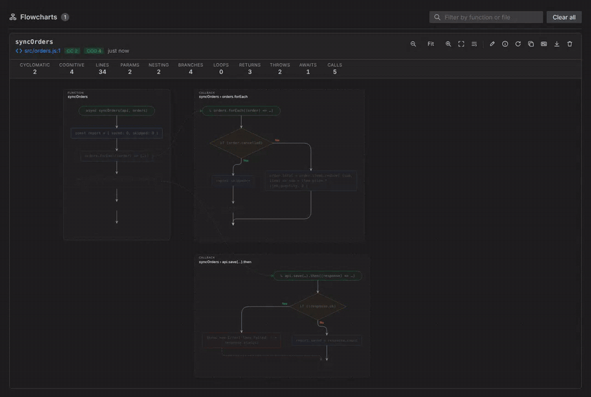
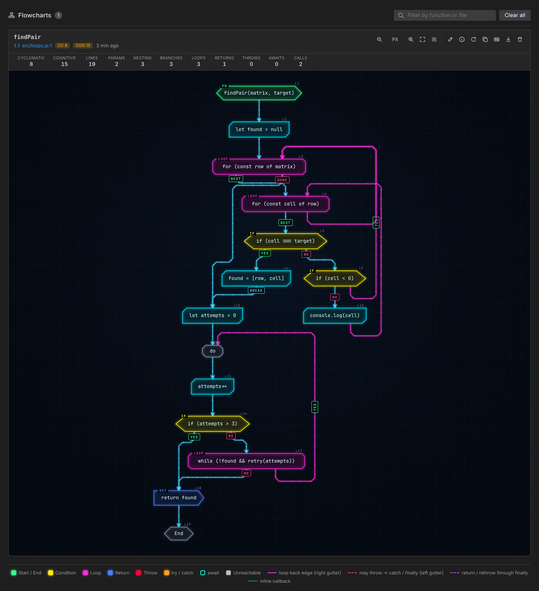
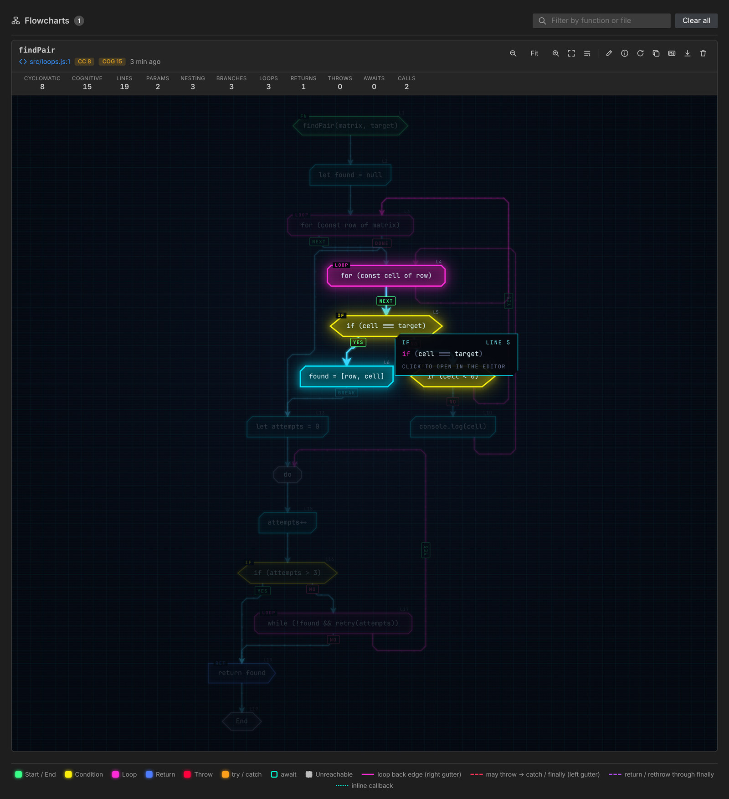
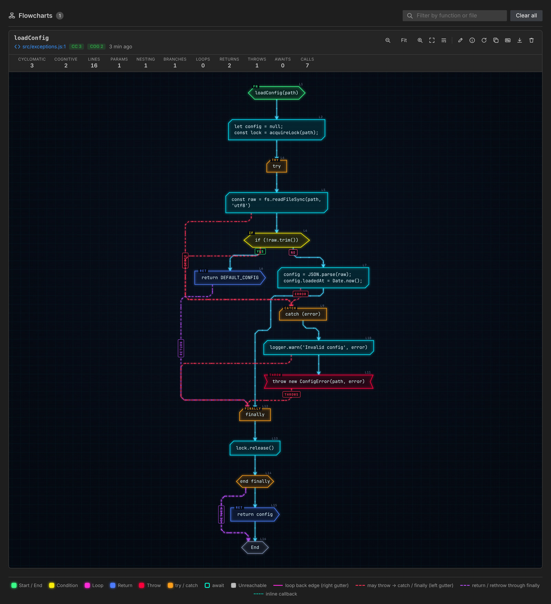
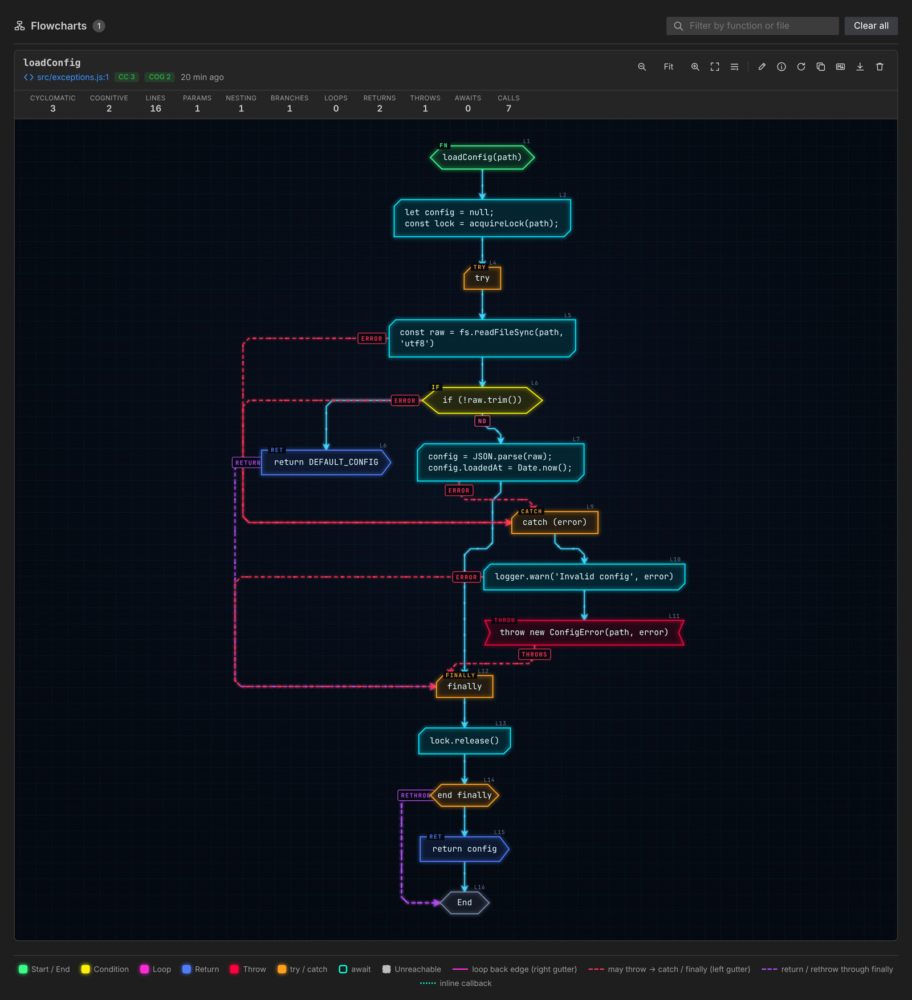
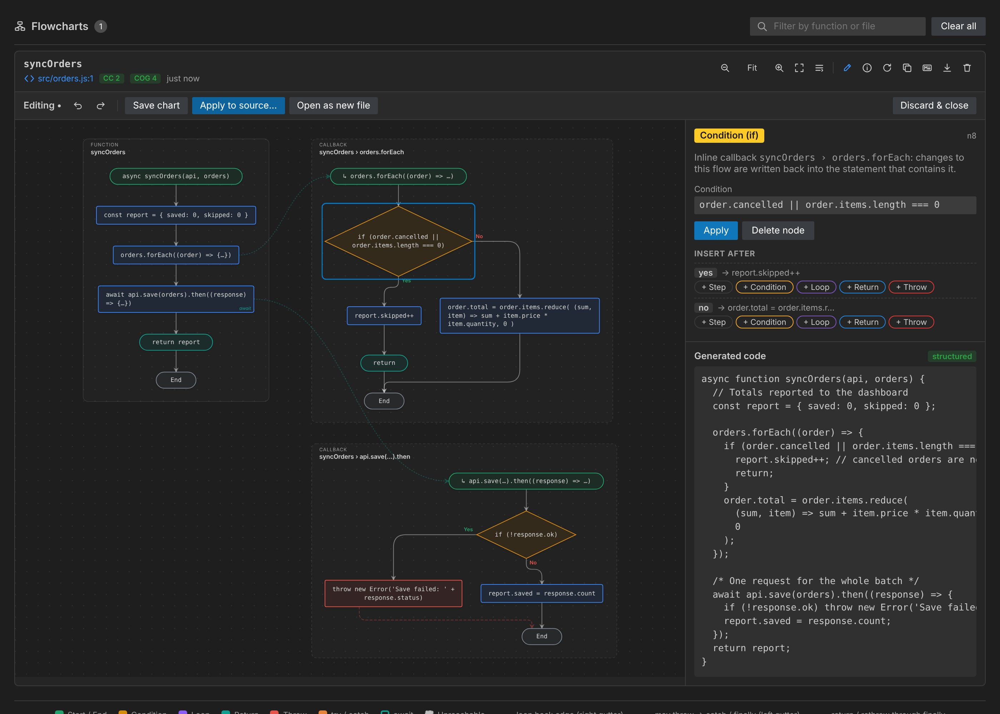

# Flowchart Generator

[](https://marketplace.visualstudio.com/items?itemName=GeneratedFlowChart.flowchartgenerator)
[](https://marketplace.visualstudio.com/items?itemName=GeneratedFlowChart.flowchartgenerator)
[](https://marketplace.visualstudio.com/items?itemName=GeneratedFlowChart.flowchartgenerator&ssr=false#review-details)
[](LICENSE.md)

**See your JavaScript and TypeScript as flowcharts, edit the flowchart, and get your code back — with your formatting and comments intact.**



```text
   ╭───────╮     ███████╗██╗      ██████╗ ██╗    ██╗ ██████╗██╗  ██╗ █████╗ ██████╗ ████████╗
   ╰───┬───╯     ██╔════╝██║     ██╔═══██╗██║    ██║██╔════╝██║  ██║██╔══██╗██╔══██╗╚══██╔══╝
  ┌────◆────┐    █████╗  ██║     ██║   ██║██║ █╗ ██║██║     ███████║███████║██████╔╝   ██║
 ┌┴─┐     ┌─┴┐   ██╔══╝  ██║     ██║   ██║██║███╗██║██║     ██╔══██║██╔══██║██╔══██╗   ██║
 └┬─┘     └─┬┘   ██║     ███████╗╚██████╔╝╚███╔███╔╝╚██████╗██║  ██║██║  ██║██║  ██║   ██║
  └────┬────┘    ╚═╝     ╚══════╝ ╚═════╝  ╚══╝╚══╝  ╚═════╝╚═╝  ╚═╝╚═╝  ╚═╝╚═╝  ╚═╝   ╚═╝
       ●          G E N E R A T O R   ·   code ⇄ flowchart for VS Code
```

## Why Flowchart Generator?

- 🔎 **Understand code in seconds.** Any function — yours, a colleague's or one written by an AI assistant — becomes a clean, classic flowchart: conditions, loops, `switch`, `try / catch / finally`, `async / await` and callbacks.
- ✏️ **Edit the chart, not just look at it.** Change a condition, add a step or a branch, delete a node: the code is regenerated live, and only what you changed is different.
- 🧠 **Spot problems.** Cyclomatic and cognitive complexity, unreachable code, empty `catch`, `await` in loops, deep nesting… each insight links to its line.
- 🔒 **Private.** Everything runs locally: no account, no network, no telemetry, no AI service.

## Quick start

1. Install **Flowchart Generator** from the Extensions view (<kbd>Ctrl</kbd>+<kbd>Shift</kbd>+<kbd>X</kbd>).
2. Open a `.js`, `.ts`, `.jsx` or `.tsx` file and put the cursor inside a function.
3. Press <kbd>Ctrl</kbd>+<kbd>Alt</kbd>+<kbd>G</kbd> (<kbd>⌘</kbd>+<kbd>⌥</kbd>+<kbd>G</kbd> on macOS) — or click the **Flowchart** link above the function.
4. Click a node to jump to its code. Click the ✏️ pencil to edit the chart, then **Apply to source…** to review a diff and update your file.

## Features

### Code → flowchart



- **The real control flow**: `if / else`, `switch` (with fall-through), `for`, `for…of`, `for…in`, `while`, `do…while`, labeled `break` / `continue`, `return`, `throw`, `try / catch / finally`, `async / await`.
- **Callbacks as their own flows**: `items.forEach(x => {…})`, `promise.then(…)`, `onClick={() => {…}}`, IIFEs and nested functions are drawn as separate, linked flows.
- **Exceptions you can follow**: every statement that may throw is linked to its `catch` or `finally`.
- **Readable labels**: long code wraps and folds nested brackets; the full code is in the tooltip of every node.
- **Click to navigate** and **live cursor sync**: click a node to select its code; move the cursor in the editor to highlight its node.
- **Metrics and insights** for every function, and **several functions at once** (a whole file).
- **Export** to SVG, PNG or Markdown (Mermaid, rendered by GitHub and GitLab).
- **Beautiful by default**: classic flowchart symbols, smooth arrows, light and dark themes, focus mode, minimap, animated zoom. An optional `cyberpunk` style is included.

| Focus mode & tooltip | Exceptions | `cyberpunk` style |
| --- | --- | --- |
|  |  |  |

### Flowchart → code



- **Visual editor**: select a node to change its code, condition, loop header or return value; insert a step, condition, loop, `return` or `throw` on any branch; delete nodes; undo / redo (<kbd>Ctrl</kbd>+<kbd>Z</kbd> / <kbd>Ctrl</kbd>+<kbd>Y</kbd>).
- **Live code preview** next to the chart.
- **Your code stays your code**: unchanged statements are printed back exactly as written — formatting, comments, blank lines, label names. Editing one node changes one line of the diff.
- **Callbacks are editable too**, parameters included; the new code goes back into the statement that contains them.
- **Apply to source safely**: a diff *original ↔ generated* is shown first, nothing changes until you confirm, and the extension refuses if the file changed in the meantime.
- **Always valid code**: structured code (`if`, loops, `switch`, `try`) whenever possible; for charts with arbitrary jumps, an equivalent state machine.
- **Design from scratch**: **Flowchart: New Flowchart (Design → Code)** starts from an empty function; insert the result at your cursor or open it in a new file.
- **Mermaid → code**: right-click a Mermaid flowchart (in Markdown or a `.mmd` file) → **Generate Code from Mermaid Flowchart**.

## Usage

| Action | How |
| --- | --- |
| Flowchart of the function under the cursor | <kbd>Ctrl</kbd>+<kbd>Alt</kbd>+<kbd>G</kbd> (<kbd>⌘</kbd>+<kbd>⌥</kbd>+<kbd>G</kbd> on macOS), the editor title button, or right-click → **Generate Flowchart** |
| Flowchart of the selection | Select code, then the same shortcut or menu |
| Flowchart of a specific function | Click the **Flowchart** CodeLens above it |
| Flowchart of the whole file | Command Palette → **Flowchart: Generate Flowchart for Entire File** |
| Edit a chart and generate code | Click the ✏️ pencil on the chart |
| Update the source from the chart | In the editor: **Apply to source…** (diff first), or **Open as new file** |
| Design a new function visually | Command Palette → **Flowchart: New Flowchart (Design → Code)** |
| Convert a Mermaid flowchart to code | Cursor in a ` ```mermaid ` block → **Flowchart: Generate Code from Mermaid Flowchart** |
| Reopen the panel / clear history | **Flowchart: Show Flowchart Panel** / **Flowchart: Clear Flowchart History** |

In the panel: <kbd>Ctrl</kbd>/<kbd>⌘</kbd> + wheel to zoom, drag to pan, double-click to fit, hover a node for its code.

### Reading the diagram

| Shape | Meaning |
| --- | --- |
| Green terminator | Function entry (`↳ …` for an inline callback) |
| Grey terminator | End of the function |
| Teal terminator | `return` |
| Blue rectangle | Statements (consecutive simple statements are grouped) |
| Amber diamond | Condition (`if` / `switch`); the main path continues downward and other branches leave from the sides |
| Violet hexagon | Loop header; loop-back arrows run on the right and enter the loop from the side |
| Red rectangle | `throw` |
| Orange rectangle with side bars | `try` / `catch` / `finally`; "end finally" closes a `finally` block |
| Rectangle with side bars | Nested function definition (its body is drawn as a linked flow) |
| Small circle `do` | Entry of a `do…while` loop |
| *await* in a node | The statement awaits a promise |
| Faded dashed node | Unreachable code |
| Faint red dashed arrow (left) | This statement may throw: control can go to the `catch` / `finally` |
| Faint violet dashed arrow | `return` / `throw` passing through `finally`, then `return` / `rethrow` |
| Faint teal dotted curve | Statement → inline callback flow, or definition → nested function flow |

## Settings

| Setting | Default | Description |
| --- | --- | --- |
| `flowchartGenerator.direction` | `TD` | Layout direction: `TD` (top to bottom) or `LR` (left to right). |
| `flowchartGenerator.style` | `classic` | `classic`: ISO flowchart symbols, smooth curved arrows, VS Code light / dark colours. `cyberpunk`: neon panels, circuit-board traces and animated flow. |
| `flowchartGenerator.animations` | `true` | Animate node appearance, layout changes while editing and, in the cyberpunk style, the flow along edges. Animations are also disabled when the OS asks for reduced motion. |
| `flowchartGenerator.labels.mode` | `wrap` | `wrap`: long code wraps on several lines and folds nested brackets when very long. `truncate`: labels are cut. |
| `flowchartGenerator.labels.lineWidth` | `40` | Characters per line in node labels (wrap mode). |
| `flowchartGenerator.labels.maxLines` | `4` | Lines per statement in node labels (wrap mode). |
| `flowchartGenerator.maxLabelLength` | `60` | Characters per label in `truncate` mode. |
| `flowchartGenerator.exceptions` | `detailed` | `detailed`: an `error` edge from every statement that may throw. `summary`: a single `try → catch` edge. |
| `flowchartGenerator.callbacks.expand` | `true` | Draw inline callbacks as their own flows. |
| `flowchartGenerator.callbacks.maxDepth` | `3` | How many levels of nested callbacks are expanded. |
| `flowchartGenerator.mergeSequentialStatements` | `true` | Group consecutive simple statements into one block. |
| `flowchartGenerator.maxStatementsPerBlock` | `4` | Maximum statements per grouped block. |
| `flowchartGenerator.codeLens.enabled` | `true` | Show the **Flowchart** CodeLens above functions. |
| `flowchartGenerator.showEditorTitleButton` | `true` | Show the generate button in the editor title bar. |
| `flowchartGenerator.openBeside` | `true` | Open the panel beside the editor. |
| `flowchartGenerator.historyLimit` | `30` | Number of flowcharts kept per workspace. |

## Supported languages

JavaScript, TypeScript, JSX and TSX: functions, arrow functions, class methods, getters / setters, object methods, CommonJS exports and top-level code. Works in untrusted workspaces and on virtual file systems.

## FAQ

**Does it send my code anywhere?**
No. Parsing, layout, rendering and code generation all run locally inside VS Code. The extension makes no network request and collects no telemetry.

**Will "Apply to source" reformat my file?**
No. Only the function shown in the chart is replaced, unchanged statements keep their exact text and comments, and you always review a diff before anything is written.

**Why does the generated code look like a state machine?**
Your chart contains a jump with no `if` / loop equivalent (for example into the middle of a loop). The state machine behaves exactly like the chart; restructure the chart to get plain `if` / loops back.

**Can I use it for documentation?**
Yes: export SVG / PNG, or copy the chart as Mermaid / Markdown, which GitHub and GitLab render.

## Requirements

VS Code 1.96 or newer. Nothing else: the extension is self-contained.

## Known limitations

- "May throw" is decided from the syntax (calls, `new`, `await`, `throw`, …); property access on `null` is not considered, which keeps diagrams readable.
- `break` / `continue` that leave a `try` with a `finally` are drawn going directly to their target.
- In state-machine mode, closures created inside a loop share the loop variables (you get a warning).
- Charts imported from Mermaid text have no original code to reuse: they are regenerated in full and their callback flows are read-only.

## Learn more

- [How it works](docs/how-it-works.md): the layout engine, the code generator and how both are verified on 13,000+ real functions.
- [Changelog](CHANGELOG.md) · [Contributing](CONTRIBUTING.md) · [Security](SECURITY.md)
- Found a bug or have an idea? [Open an issue](https://github.com/dahhou-ilyas/vsExtension-mermaide/issues).

## License

[MIT](LICENSE.md) © Ilyas Dahhou
