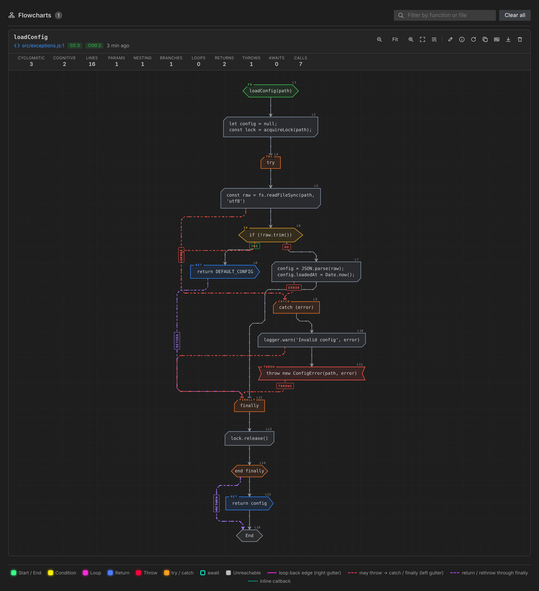
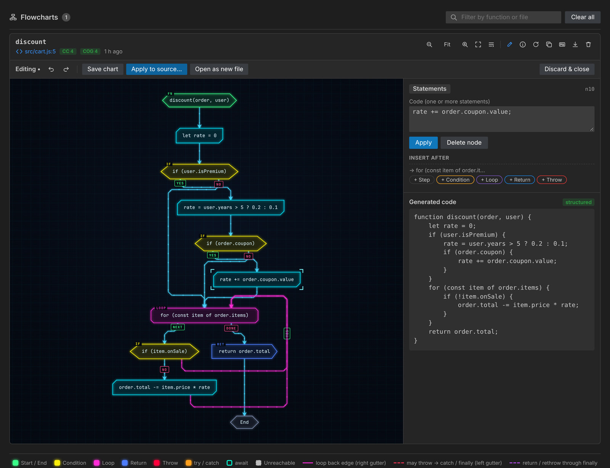
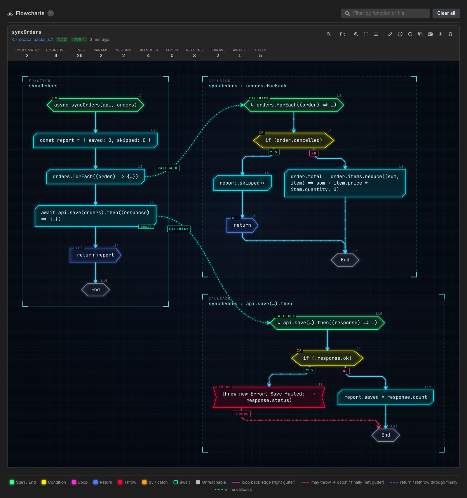

# Flowchart Generator

**Turn JavaScript and TypeScript into interactive flowcharts, and flowcharts back into code, right inside VS Code.**

Flowchart Generator parses your code, builds its real control-flow graph and draws it with its **own rendering engine**: a layered layout made for control flow, neon "circuit-board" traces, animated flow, focus mode and minimap. Click any node to jump to the code. The panel also shows complexity metrics and actionable insights.

It also works in the other direction: **edit the chart and the code is regenerated live**. You can then apply it to your source after reviewing a diff, design a function from scratch, or convert any Mermaid flowchart into code.


## Features

### Rendering engine

Flowcharts are drawn by a purpose-built engine (no Mermaid, no layout library):

- **Layout made for control flow.** It uses the Sugiyama layered method (cycle removal, layering, crossing reduction with barycenter sweeps), with coordinates computed by an exact least-squares overlap removal (isotonic regression). `yes` branches go left and `no` branches go right.
- **Readable loops and exceptions.** Following the VEIL study of CFG readability, loop back edges run in a gutter on the right and exceptional flow in a gutter on the left. Edges going to the same target share one lane, like a bus on a circuit board.
- **Cyberpunk style.** Neon panels with chamfered corners, PCB traces with 45° bends, HUD tags and corner brackets, animated packets showing the direction of flow, and a staggered appear animation. A `minimal` style follows the VS Code theme instead.
- **Fluid interaction.** Animated zoom around the pointer (<kbd>Ctrl</kbd>/<kbd>⌘</kbd> + wheel or pinch), drag to pan, double-click to fit, and a minimap. Hovering a node dims everything else (focus mode) and shows a tooltip with its highlighted code. In the editor, nodes glide to their new place and traces morph.
- **Light and fast.** The panel bundle is about 11× smaller than with Mermaid (324 KB instead of 3.6 MB), and laying out a function takes 0.4 ms on average.
- **Self-contained exports.** SVG and PNG exports embed their styles. Mermaid text is still available (copy / Markdown) for documentation.

| Focus mode & tooltip | Minimal style |
| --- | --- |
|  |  |

### Code → flowchart

- **Accurate control flow**: `if / else if / else`, `switch` (with fall-through), `for`, `for…of`, `for…in`, `while`, `do…while`, `break` / `continue` (including labels), `return`, `throw`, `try / catch / finally`, `async` / `await`.
- **Inline callbacks as their own flows**: `items.forEach(x => {…})`, `promise.then(…)`, `onClick={() => {…}}`, IIFEs and nested functions are drawn as separate, linked flows (nested callbacks up to a configurable depth). The statement shows the body folded (`=> {…}`), so it is not repeated.
- **Precise exceptions**: like Soot's exceptional CFG, only statements that can throw (calls, `new`, `await`, `throw`, …) get an `error` edge to their `catch`. `return` and `throw` go through `finally`, and an explicit "end finally" node continues with `then return` / `rethrow`.
- **Readable long code**: labels wrap on several lines instead of being cut, and very long code folds nested brackets innermost first (`fetch(url, { headers: {…}, retry: 3 })`). The full code is in every node's tooltip, and the **full labels** toggle shows it in the nodes.
- **JavaScript, TypeScript, JSX and TSX**: functions, arrow functions, class methods, getters/setters, object methods, CommonJS exports and loose statements.
- **Smart targeting**: select code, or just put the cursor inside a function. You can also click the **Flowchart** CodeLens above any function.
- **Click to navigate**: every node is linked to its source range. Click a node to open and select the matching code.
- **Live cursor sync**: moving the cursor in the editor highlights the matching node in the diagram.
- **Code metrics**: cyclomatic complexity (McCabe), cognitive complexity (SonarSource), lines, parameters, nesting depth, branches, loops, returns, throws, awaits and calls.
- **Insights**: unreachable code, empty `catch` blocks, `await` inside loops, deep nesting, high complexity, long functions, too many parameters, recursion, missing `default` cases and leftover `debugger` statements. Each insight links to its line.
- **Multiple functions at once**: each function is drawn in its own titled group, with a per-function metrics table.
- **Export**: SVG and high-resolution PNG (rendered by the engine), Markdown (a `mermaid` code block, which renders on GitHub and GitLab) or the Mermaid definition copied to the clipboard.
- **Comfortable viewer**: zoom (buttons or <kbd>Ctrl</kbd>/<kbd>⌘</kbd> + wheel), fit to width, drag to pan, filtering and keyboard navigation.
- **Two styles**: `cyberpunk` (default) or `minimal`, which follows the VS Code theme.
- **History**: flowcharts are kept per workspace and survive reloads. Use **Regenerate** to refresh one after editing the code.
- **Private by design**: all analysis runs locally. No network access and no telemetry, and the webview runs under a strict Content Security Policy.

### Flowchart → code



- **Visual editor**: click **Edit** (pencil) on any chart, select a node and change its code, condition, loop header or return value, or rename the function and edit its parameters.
- **Insert and delete**: add a step, condition, loop, `return` or `throw` after any node or on any branch. Deleting a condition keeps its "yes" branch, and deleting a loop keeps the code after it.
- **Live code preview**: the code is regenerated on every change, next to the chart.
- **Undo / redo**: <kbd>Ctrl</kbd>+<kbd>Z</kbd> / <kbd>Ctrl</kbd>+<kbd>Y</kbd>, with up to 100 steps.
- **Apply to source**: a diff editor shows *original ↔ generated* code. Nothing changes until you confirm, and the original indentation is preserved. The extension refuses to apply if the source changed since the chart was generated.
- **Design from scratch**: **Flowchart: New Flowchart** creates an empty function to design visually, then inserts the generated code at your cursor or opens it in a new file.
- **Mermaid → code**: **Flowchart: Generate Code from Mermaid Flowchart** converts any `flowchart` / `graph` diagram, for example one from a Markdown file. It understands node shapes (`{condition}`, `{{loop}}`, `(return …)`, …) and yes/no edge labels in English or French, and it recognizes loops.
- **Correct by construction**: the generator rebuilds structured code (`if / else if / else`, loops, `switch` with fall-through, `try / catch / finally`, labeled `break` / `continue` only when needed). If a hand-drawn chart has no structured equivalent, it falls back to an equivalent state machine and tells you so.

#### How the code generation works

1. The chart is stored as a graph whose nodes keep the original, untruncated code.
2. Merge points are found with immediate post-dominators, which is the same approach compilers use to emit structured code (Relooper / Stackifier).
3. Loops are identified from their back edges. `break` and `continue` come from jumps to a loop's exit or header, and labels are added only when a jump crosses several loops or a `switch`.
4. If a part of the chart cannot be expressed this way (jumping into the middle of a loop, for example), the function is generated as a `while (true) { switch (state) { … } }` state machine. The Böhm–Jacopini theorem guarantees this is always possible and preserves the behaviour exactly.

The test suite checks this end to end. Each sample function goes code → chart → code (and code → Mermaid text → code), and the original and regenerated versions are executed on the same inputs and must return the same results.

#### Verified on real-world code

The generator was also run on **11,345 functions** from webpack, ESLint, Mocha, Babel and Acorn:

| Check | Result |
| --- | --- |
| Flowchart built without error | 11,345 / 11,345 |
| Regenerated code is valid JavaScript | 11,341 / 11,345 (4 very irregular functions get an explicit message) |
| Rebuilt as structured code (not a state machine) | 99.95 % |
| Mermaid export accepted by Mermaid | 400 / 400 sampled diagrams |
| Layout: overlapping nodes / detached or non-orthogonal edges / nodes outside their frame | 0 on 12,969 functions (139,537 nodes) |
| Layout time | 0.4 ms on average, 136 ms for the largest (410 nodes) |
| code → Mermaid *text* → import → valid code | 3,127 / 3,147 (99.4 %) |

## Usage

| Action | How |
| --- | --- |
| Flowchart of the function under the cursor | <kbd>Ctrl</kbd>+<kbd>Alt</kbd>+<kbd>G</kbd> (<kbd>⌘</kbd>+<kbd>⌥</kbd>+<kbd>G</kbd> on macOS) |
| Flowchart of the selection | Select code, then use the same shortcut or right-click → **Generate Flowchart** |
| Flowchart of a specific function | Click the **Flowchart** CodeLens above it |
| Flowchart of the entire file | Command Palette → **Flowchart: Generate Flowchart for Entire File** |
| Reopen the panel | Command Palette → **Flowchart: Show Flowchart Panel** |
| Delete all flowcharts | Command Palette → **Flowchart: Clear Flowchart History** |
| Edit a chart and generate code | Click the pencil icon on a chart |
| Design a new function visually | Command Palette → **Flowchart: New Flowchart (Design → Code)** |
| Convert a Mermaid flowchart to code | Put the cursor in a ` ```mermaid ` block (or select the diagram) → **Flowchart: Generate Code from Mermaid Flowchart** |

### Reading the diagram

| Shape | Meaning |
| --- | --- |
| Green hexagonal capsule `FN` | Function entry (`CALLBACK` for an inline callback) |
| Grey hexagonal capsule | End of the function |
| Cyan panel with chamfered corners | Statements (consecutive simple statements are grouped) |
| Yellow hexagon `IF` / `SWITCH` | Condition; `yes` leaves on the left, `no` on the right |
| Magenta octagon `LOOP` | Loop header; its back edges run in the right gutter |
| Blue arrow `RET` | `return` |
| Red notched panel `THROW` | `throw` |
| Orange panels `TRY` / `CATCH` / `FINALLY` | Exception handling; "end finally" closes a `finally` block |
| Teal `AWAIT` badge | Contains `await` |
| `DEF` panel | Nested function definition (its body is drawn as a linked flow) |
| Dimmed dashed node | Unreachable code |
| Red dashed trace (left gutter) | This statement may throw: control can go to the `catch` / `finally` |
| Purple dashed trace | `return` / `throw` passing through `finally`, then `return` / `rethrow` |
| Teal dotted curve | Statement → inline callback flow, or definition → nested function flow |

### Callbacks, exceptions and long labels

| Inline callbacks | Precise exceptions |
| --- | --- |
|  |  |

## Settings

| Setting | Default | Description |
| --- | --- | --- |
| `flowchartGenerator.direction` | `TD` | Layout direction: `TD` (top to bottom) or `LR` (left to right). |
| `flowchartGenerator.style` | `cyberpunk` | `cyberpunk`: neon panels, glowing traces and animated flow. `minimal`: sober colours that follow the VS Code theme. |
| `flowchartGenerator.animations` | `true` | Animate the flow along edges, node appearance and layout changes. Animations are also disabled when the OS asks for reduced motion. |
| `flowchartGenerator.labels.mode` | `wrap` | `wrap`: long code wraps on several lines and folds nested brackets when very long. `truncate`: labels are cut. |
| `flowchartGenerator.labels.lineWidth` | `40` | Characters per line in node labels (wrap mode). |
| `flowchartGenerator.labels.maxLines` | `4` | Lines per statement in node labels (wrap mode). |
| `flowchartGenerator.maxLabelLength` | `60` | Characters per label in `truncate` mode. |
| `flowchartGenerator.exceptions` | `detailed` | `detailed`: an `error` edge from every statement that may throw. `summary`: a single `try → catch` edge. |
| `flowchartGenerator.callbacks.expand` | `true` | Draw inline callbacks as their own flows. |
| `flowchartGenerator.callbacks.maxDepth` | `3` | How many levels of nested callbacks are expanded. |
| `flowchartGenerator.mergeSequentialStatements` | `true` | Group consecutive simple statements into one block. |
| `flowchartGenerator.maxStatementsPerBlock` | `4` | Maximum statements per grouped block. |
| `flowchartGenerator.codeLens.enabled` | `true` | Show the **Flowchart** CodeLens above functions. |
| `flowchartGenerator.showEditorTitleButton` | `true` | Show the generate button in the editor title bar. |
| `flowchartGenerator.openBeside` | `true` | Open the panel beside the editor. |
| `flowchartGenerator.historyLimit` | `30` | Number of flowcharts kept per workspace. |

## Requirements

VS Code 1.96 or newer. No other dependency: everything is bundled.

## Known limitations

- "May throw" is decided syntactically (calls, `new`, `await`, `yield`, tagged templates, `throw`). Property access on `null` is not considered, which keeps diagrams readable.
- Callback flows are read-only in the editor: edit the statement that contains the callback instead.
- `break` / `continue` that leave a `try` block with a `finally` are drawn going directly to their target.
- Comments are not shown in the diagram, so they are not part of the regenerated code either. Review the diff before applying.
- Generated code is laid out with 4-space indentation. Run your formatter afterwards if your project uses another style.
- In state-machine mode, destructuring declarations and `for` / `try` blocks cannot be converted. Restructure the chart in that case.

## Development

```bash
npm install
npm run watch        # rebuild on change, then press F5 to launch the Extension Development Host
npm run lint
npm run test:unit    # fast parser tests (Node)
npm test             # unit + integration tests (downloads VS Code)
npm run vsix         # build a .vsix package
```

The architecture is described in [CONTRIBUTING.md](CONTRIBUTING.md).

## License

[MIT](LICENSE.md)
