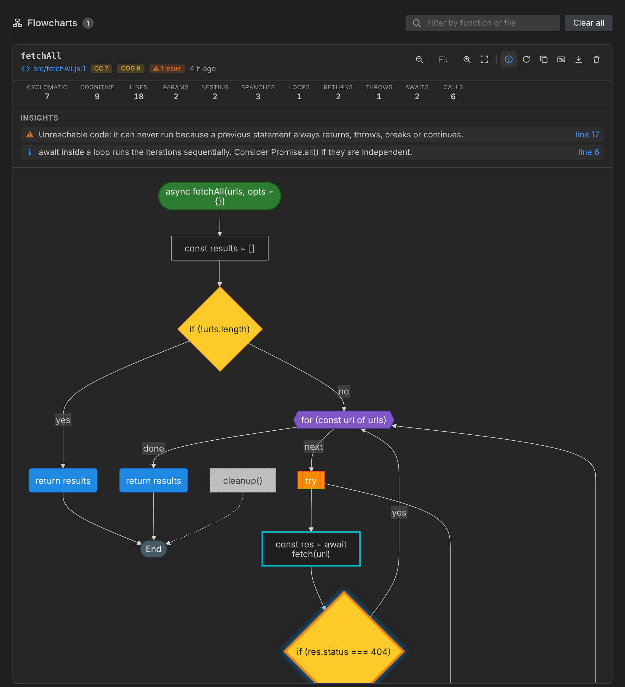
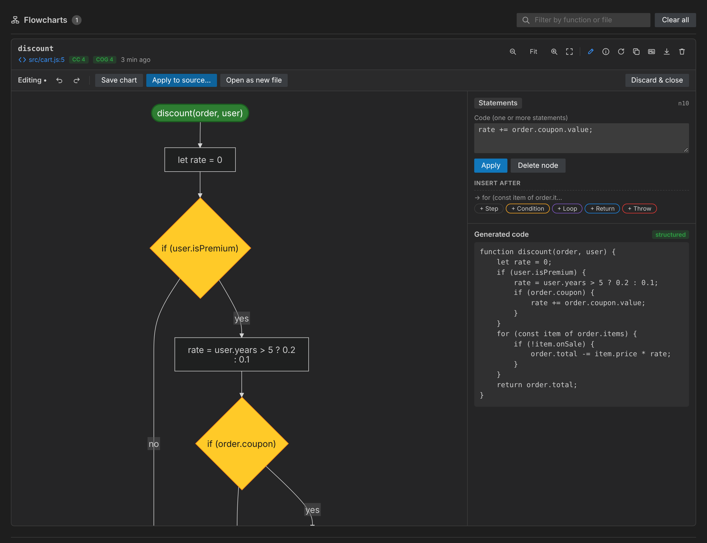

# Flowchart Generator

**Turn JavaScript and TypeScript into interactive flowcharts, and flowcharts back into code, right inside VS Code.**

Flowchart Generator parses your code, builds its real control-flow graph and renders it with Mermaid. Click any node to jump to the code. The panel also shows complexity metrics and actionable insights.

It also works in the other direction: **edit the chart and the code is regenerated live**. You can then apply it to your source after reviewing a diff, design a function from scratch, or convert any Mermaid flowchart into code.



## Features

### Code → flowchart

- **Accurate control flow**: `if / else if / else`, `switch` (with fall-through), `for`, `for…of`, `for…in`, `while`, `do…while`, `break` / `continue` (including labels), `return`, `throw`, `try / catch / finally`, `async` / `await`.
- **JavaScript, TypeScript, JSX and TSX**: functions, arrow functions, class methods, getters/setters, object methods, CommonJS exports and loose statements.
- **Smart targeting**: select code, or just put the cursor inside a function. You can also click the **Flowchart** CodeLens above any function.
- **Click to navigate**: every node is linked to its source range. Click a node to open and select the matching code.
- **Live cursor sync**: moving the cursor in the editor highlights the matching node in the diagram.
- **Code metrics**: cyclomatic complexity (McCabe), cognitive complexity (SonarSource), lines, parameters, nesting depth, branches, loops, returns, throws, awaits and calls.
- **Insights**: unreachable code, empty `catch` blocks, `await` inside loops, deep nesting, high complexity, long functions, too many parameters, recursion, missing `default` cases and leftover `debugger` statements. Each insight links to its line.
- **Multiple functions at once**: each function is drawn in its own titled group, with a per-function metrics table.
- **Export**: SVG, high-resolution PNG, Markdown (a `mermaid` code block, which renders on GitHub and GitLab) or the raw Mermaid definition copied to the clipboard.
- **Comfortable viewer**: zoom (buttons or <kbd>Ctrl</kbd>/<kbd>⌘</kbd> + wheel), fit to width, drag to pan, filtering and keyboard navigation.
- **Theme aware**: follows the light, dark and high-contrast VS Code themes, or uses a Mermaid theme of your choice.
- **History**: flowcharts are kept per workspace and survive reloads. Use **Regenerate** to refresh one after editing the code.
- **Private by design**: all analysis runs locally. No network access and no telemetry, and the webview runs under a strict Content Security Policy.

### Flowchart → code



- **Visual editor**: click **Edit** (pencil) on any chart, select a node and change its code, condition, loop header or return value, or rename the function and edit its parameters.
- **Insert and delete**: add a step, condition, loop, `return` or `throw` after any node or on any branch. Deleting a condition keeps its "yes" branch, and deleting a loop keeps the code after it.
- **Live code preview**: the code is regenerated on every change, next to the chart.
- **Undo / redo**: <kbd>Ctrl</kbd>+<kbd>Z</kbd> / <kbd>Ctrl</kbd>+<kbd>Y</kbd>, with up to 100 steps.
- **Apply to source**: a diff editor shows *original ↔ generated* code. Nothing changes until you confirm, and the original indentation is preserved. The extension refuses to apply if the source changed since the chart was generated.
- **Design from scratch**: **Flowchart: New Flowchart** creates an empty function to design visually, then inserts the generated code at your cursor or opens it in a new file.
- **Mermaid → code**: **Flowchart: Generate Code from Mermaid Flowchart** converts any `flowchart` / `graph` diagram, for example one from a Markdown file. It understands node shapes (`{condition}`, `{{loop}}`, `(return …)`, …) and yes/no edge labels in English or French, and it recognizes loops.
- **Correct by construction**: the generator rebuilds structured code (`if / else if / else`, loops, `switch` with fall-through, `try / catch / finally`, labeled `break` / `continue` only when needed). If a hand-drawn chart has no structured equivalent, it falls back to an equivalent state machine and tells you so.

#### How the code generation works

1. The chart is stored as a graph whose nodes keep the original, untruncated code.
2. Merge points are found with immediate post-dominators, which is the same approach compilers use to emit structured code (Relooper / Stackifier).
3. Loops are identified from their back edges. `break` and `continue` come from jumps to a loop's exit or header, and labels are added only when a jump crosses several loops or a `switch`.
4. If a part of the chart cannot be expressed this way (jumping into the middle of a loop, for example), the function is generated as a `while (true) { switch (state) { … } }` state machine. The Böhm–Jacopini theorem guarantees this is always possible and preserves the behaviour exactly.

The test suite checks this end to end. Each sample function goes code → chart → code (and code → Mermaid text → code), and the original and regenerated versions are executed on the same inputs and must return the same results.

## Usage

| Action | How |
| --- | --- |
| Flowchart of the function under the cursor | <kbd>Ctrl</kbd>+<kbd>Alt</kbd>+<kbd>G</kbd> (<kbd>⌘</kbd>+<kbd>⌥</kbd>+<kbd>G</kbd> on macOS) |
| Flowchart of the selection | Select code, then use the same shortcut or right-click → **Generate Flowchart** |
| Flowchart of a specific function | Click the **Flowchart** CodeLens above it |
| Flowchart of the entire file | Command Palette → **Flowchart: Generate Flowchart for Entire File** |
| Reopen the panel | Command Palette → **Flowchart: Show Flowchart Panel** |
| Delete all flowcharts | Command Palette → **Flowchart: Clear Flowchart History** |
| Edit a chart and generate code | Click the pencil icon on a chart |
| Design a new function visually | Command Palette → **Flowchart: New Flowchart (Design → Code)** |
| Convert a Mermaid flowchart to code | Put the cursor in a ` ```mermaid ` block (or select the diagram) → **Flowchart: Generate Code from Mermaid Flowchart** |

### Reading the diagram

| Shape | Meaning |
| --- | --- |
| Green stadium | Function entry |
| Grey stadium | End of the function |
| Rectangle | Statements (consecutive simple statements are grouped) |
| Yellow diamond | `if` / `switch` condition |
| Purple hexagon | Loop header |
| Blue rounded box | `return` |
| Red flag | `throw` |
| Orange box | `try` / `catch` / `finally` |
| Cyan border | Contains `await` |
| Dashed grey box | Unreachable code |

## Settings

| Setting | Default | Description |
| --- | --- | --- |
| `flowchartGenerator.direction` | `TD` | Layout direction: `TD` (top to bottom) or `LR` (left to right). |
| `flowchartGenerator.theme` | `auto` | `auto` follows VS Code; or `default`, `dark`, `forest`, `neutral`. |
| `flowchartGenerator.maxLabelLength` | `60` | Characters shown in a node before truncation. |
| `flowchartGenerator.mergeSequentialStatements` | `true` | Group consecutive simple statements into one block. |
| `flowchartGenerator.maxStatementsPerBlock` | `4` | Maximum statements per grouped block. |
| `flowchartGenerator.codeLens.enabled` | `true` | Show the **Flowchart** CodeLens above functions. |
| `flowchartGenerator.showEditorTitleButton` | `true` | Show the generate button in the editor title bar. |
| `flowchartGenerator.openBeside` | `true` | Open the panel beside the editor. |
| `flowchartGenerator.historyLimit` | `30` | Number of flowcharts kept per workspace. |

## Requirements

VS Code 1.96 or newer. No other dependency: everything is bundled.

## Known limitations

- Exceptional control flow is simplified: any statement inside `try` may jump to `catch`, which is drawn as a single `error` edge from `try`.
- Callbacks passed inline (for example `items.forEach(x => …)`) appear as a single statement. Generate a flowchart for the callback itself to see its flow.
- Comments are not shown in the diagram, so they are not part of the regenerated code either. Review the diff before applying.
- Generated code is laid out with 4-space indentation. Run your formatter afterwards if your project uses another style.
- In state-machine mode, destructuring declarations and `for` / `try` blocks cannot be converted. Restructure the chart in that case.

## Development

```bash
npm install
npm run watch        # rebuild on change, then press F5 to launch the Extension Development Host
npm run lint
npm run test:unit    # fast parser tests (Node)
npm test             # unit + integration tests (downloads VS Code)
npm run vsix         # build a .vsix package
```

The architecture is described in [CONTRIBUTING.md](CONTRIBUTING.md).

## License

[MIT](LICENSE.md)
